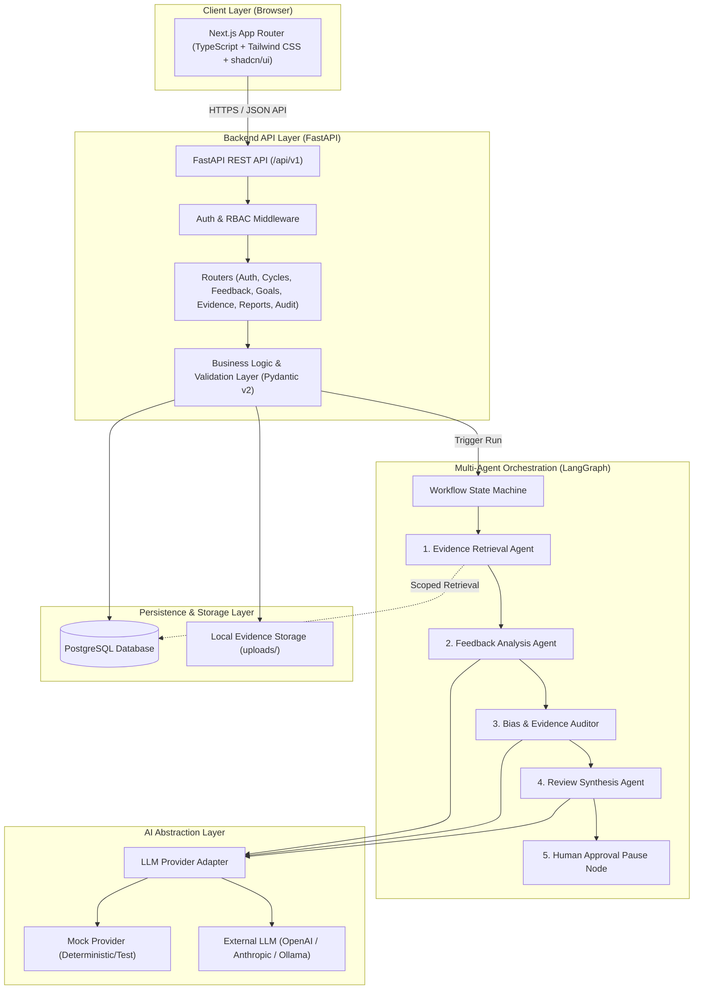
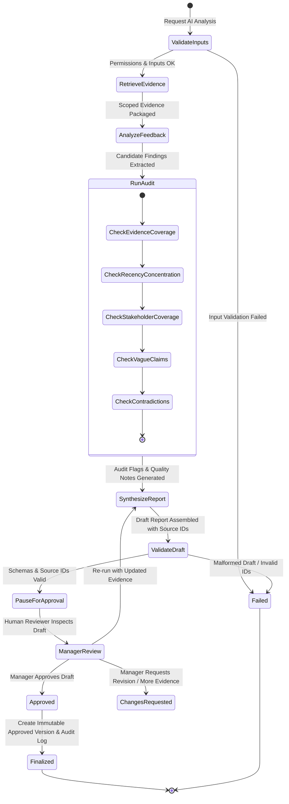
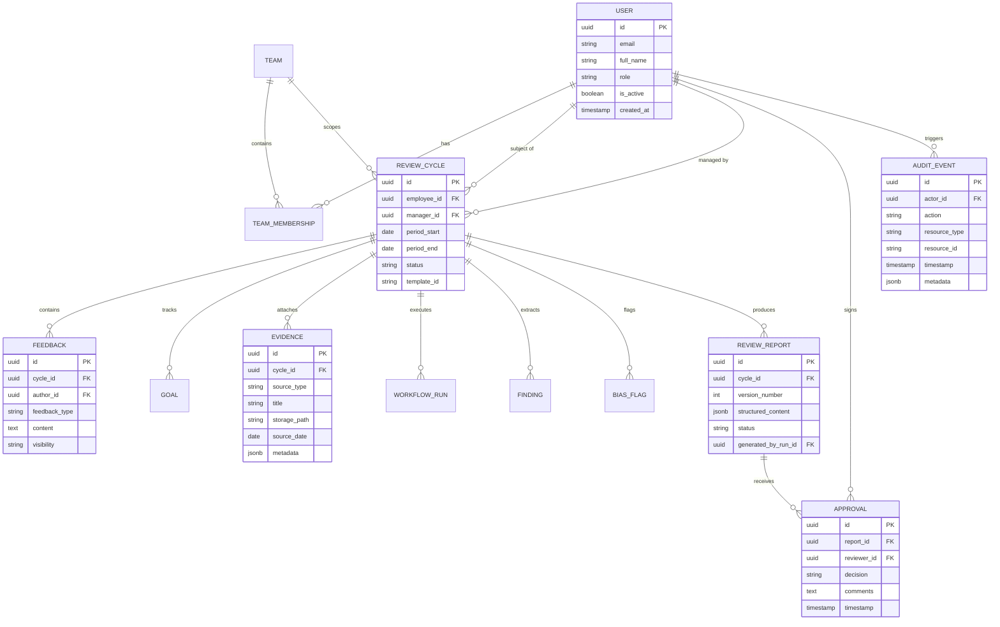

# PERFORMai-360: System Architecture Specification

**Project Title:** PERFORMai-360: AI-Driven Bias-Aware 360° Performance Evaluation for Software Engineering Teams
**Document Status:** Baseline (Phase 0 Planning)
**Target Environment:** macOS Local Development, Docker Compose, Python 3.14+, Node.js v26+

---

## 1. Architectural Vision and Core Principles

PERFORMai-360 is an evidence-grounded performance review intelligence system. It assists software engineering managers and organizations in synthesizing 360-degree feedback, detecting potential evidence gaps and review imbalances, and drafting transparent review reports.

The architecture is governed by five non-negotiable principles:

1. **Human-in-the-Loop Decision Support:** The system is strictly an assistance tool. Consequential decisions (promotions, compensation, termination) must never be made autonomously. Reports require human review, editing, and explicit approval before finalization.
2. **Evidence Traceability:** Every factual finding in an AI-generated draft must be linked to verifiable source evidence identifiers (`evidence_ids`). If evidence is insufficient, the system explicitly reports an evidence gap rather than hallucinating details.
3. **Deterministic Bias & Review-Quality Auditing:** Imbalances (recency bias, lack of stakeholder diversity, ungrounded claims, vague language) are flagged by transparent, explainable audit rules to prompt human reflection.
4. **Data Isolation & Least Privilege:** Role-based access control (RBAC) is strictly enforced server-side. Employees, peers, managers, and administrators only access records permitted by organizational policy.
5. **Provider-Agnostic AI Layer:** The multi-agent workflow operates behind a provider-neutral abstraction, supporting offline mock providers for development and testing without paid API dependencies.

---

## 2. High-Level System Architecture

---

## 3. Technology Stack and Rationale

| Layer | Component | Selection | Rationale |
| :--- | :--- | :--- | :--- |
| **Frontend** | Framework | Next.js (App Router, React 19 / TypeScript) | Type-safe, component-driven, responsive UI for review workflows |
| **Frontend** | Styling / UI | Tailwind CSS + shadcn/ui | Clean, accessible design system with customizable components |
| **Frontend** | Visualizations | Recharts | Clear visual indicators for review coverage, date distribution, and metrics |
| **Backend** | Framework | Python + FastAPI | High-performance asynchronous API, native Pydantic schema validation, clean modular design |
| **Backend** | ORM & Migrations | SQLAlchemy 2.0 (asyncio) + Alembic | Mature relational mapping, transactional integrity, and versioned schema migrations |
| **Database** | Primary Store | PostgreSQL 16+ | Strong ACID compliance, relational integrity, JSON support, and future-ready for pgvector |
| **Orchestration** | Multi-Agent Engine | LangGraph | Deterministic state machine supporting branching, validation nodes, and human approval pauses |
| **AI Integration** | Provider Adapter | Provider-Neutral Adapter | Decouples business logic from external LLM vendors; supports offline mock provider |
| **Testing** | Suite | pytest (backend), Vitest (frontend), Playwright (E2E) | Comprehensive multi-tier automated testing strategy |
| **Local Services** | Containerization | Docker Compose | Reproducible local PostgreSQL and supporting service environments |

---

## 4. Multi-Agent Workflow Architecture

The multi-agent evaluation pipeline is organized as an explicit, observable state graph in LangGraph. Each stage has typed Pydantic input and output contracts:

### Specialist Agent Responsibilities:
1. **Evidence Retrieval Agent:** Queries and filters authorized inputs (self-assessment, peer feedback, manager notes, goals, uploaded evidence) restricted to the employee, review cycle, and requesting user's scope.
2. **Feedback Analysis Agent:** Extracts candidate strengths, achievements, growth opportunities, and goal progress, tagging each finding with source evidence references.
3. **Bias & Evidence Auditor:** Executes deterministic rules and heuristics:
   - *Evidence Coverage:* Identifies ungrounded or unsupported evaluative claims.
   - *Recency Concentration:* Detects disproportionate reliance on events at the end of the review window.
   - *Stakeholder Coverage:* Assesses feedback balance across peers, self, and manager.
   - *Vague / Absolute Language:* Flags generalizations ("always", "never", "poor attitude") lacking concrete work context.
   - *Contradictory Feedback:* Identifies conflicting reviewer perspectives for human reconciliation.
4. **Review Synthesis Agent:** Formats validated findings, audit flags, goal progress, and limitations into a structured draft report.
5. **Human Approval Pause:** Halts automated execution until an authorized human manager reviews, edits, and explicitly decides (Approve, Reject, Request Changes).

---

## 5. Core Domain Entities & Relational Design

---

## 6. Security, Privacy, and Audit Controls

- **Role-Based Access Control (RBAC):** Backend endpoints authenticate callers via JWT tokens and verify role permissions (`Employee`, `Peer Reviewer`, `Manager`, `Administrator`).
- **Data Isolation:** All database queries are filtered by tenant/employee and cycle scope. Peer feedback visibility policies are enforced at the service layer.
- **Audit Logging:** Critical events (logins, evidence uploads, analysis triggers, report revisions, approval decisions) generate immutable, append-only `AuditEvent` records. Sensitive credentials or confidential prompts are never logged.
- **Untrusted File Parsing:** Uploaded documents (PDF, DOCX, TXT, CSV) are treated as untrusted data. Files undergo strict MIME validation, file size limits (default 10 MB), and safe parsing in isolation.
- **Synthetic Data Baseline:** Test fixtures and demo scenarios strictly utilize synthetic identities to guarantee privacy during demonstrations.

---

## 7. Phased Implementation Strategy

Development is executed sequentially across twelve controlled phases:
- **Phase 0:** Repository and Planning Baseline *(Current)*
- **Phase 1:** Application Skeleton & Local Developer Environment
- **Phase 2:** Database, Migrations, and Authentication
- **Phase 3:** Core Review Workflow (Cycles, Feedback, Goals, Evidence)
- **Phase 4:** Evidence Processing & Scoped Retrieval
- **Phase 5:** Single-Pass AI Analysis & Grounded Report Draft
- **Phase 6:** Deterministic Bias & Evidence-Quality Audit Engine
- **Phase 7:** LangGraph Multi-Agent Orchestration
- **Phase 8:** Human Approval, Report Versioning, and Governance
- **Phase 9:** Dashboard Polish, Accessibility, and Export
- **Phase 10:** Comprehensive Testing, Security, and Quality Review
- **Phase 11:** Final Documentation, Evaluation Metrics, and Demonstration Readiness
